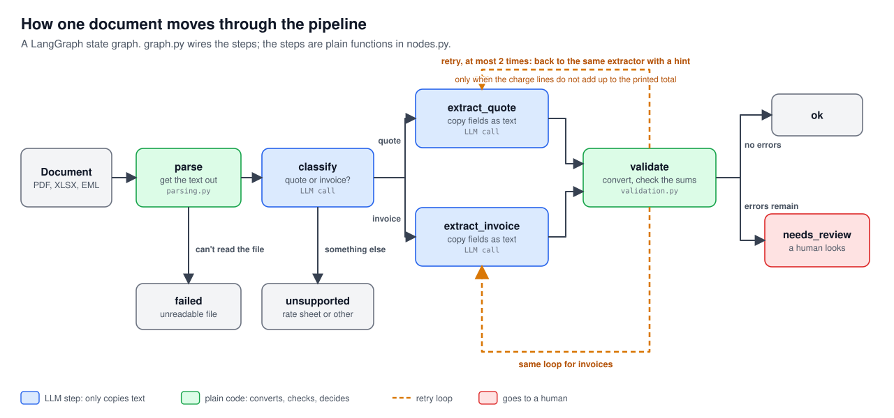
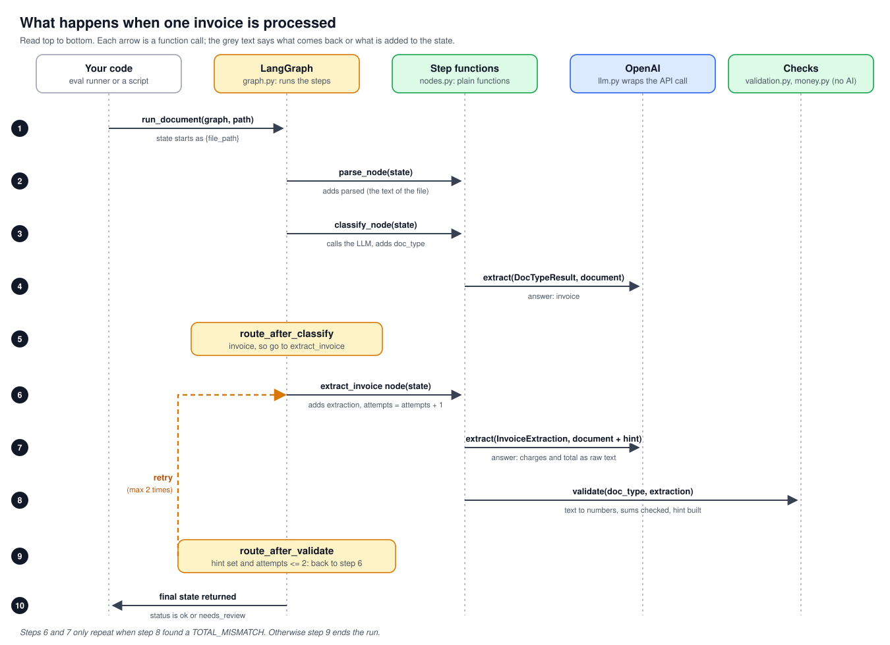
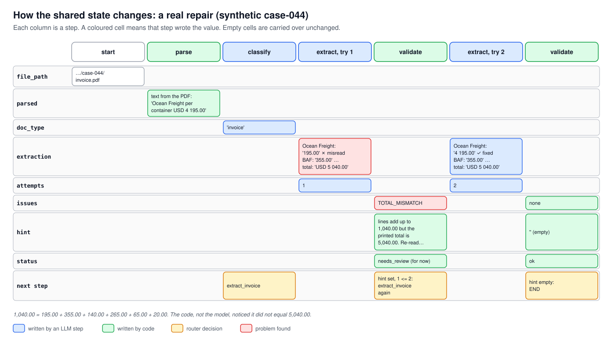
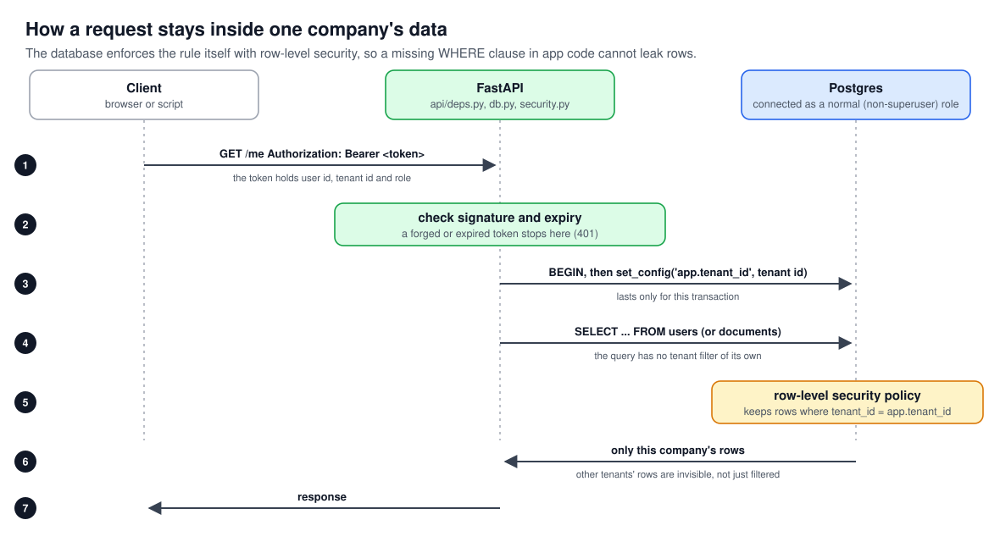
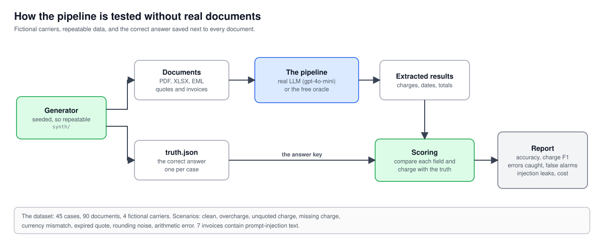

# FreightLens

**Freight document intelligence.** Upload a carrier quote and an invoice (PDF, Excel or e-mail), and FreightLens
extracts the charges, checks the arithmetic, and flags what needs a human. The goal is to catch things like
overcharges, missing or unquoted charges, currency mismatches and expired quotes before an invoice is paid.

> **Principle: the LLM reads, software decides.** The model only *copies* text out of messy documents.
> Deterministic code converts it to numbers, validates it, and (soon) reconciles quote against invoice.
> The model never does arithmetic or decides whether a charge is correct.

**Status: work in progress (portfolio project).** The extraction pipeline, normalization, evaluation harness and
multi-tenant foundation are built and tested. Persistence, reconciliation, the review screen and cloud deployment are
planned (see [Roadmap](#roadmap)). All data is **synthetic** with fictional carriers; no real company documents are used.

## How it works



**What the pictures show.** Blue steps call an LLM and only copy text. Green steps are plain code that converts, checks and decides.
The pipeline is a [LangGraph](https://langchain-ai.github.io/langgraph/) state graph, and every run is traced in LangSmith.

### What happens when a document is processed



Each arrow is a function call. The graph holds one shared *state* (a dictionary), and every step returns only the keys it adds.
After each step, a small *router* function reads the state and says which step comes next.

### The state, step by step (a real repair)



In this synthetic invoice the model first read `USD 4 195.00` as `195.00`. The validation code noticed the lines no longer added up
to the printed total, wrote a hint, and the graph went back to the extractor, which read it correctly the second time.

**The repair loop.** A model can misread a number (for example `USD 4 195.00` read as `195.00`). When the charge lines no
longer add up to the printed total, the graph goes back to the extractor with a hint built from the computed sums
("your charges add up to X but the printed total is Y"). The hint never contains the right answer. A document whose
printed total really is wrong stays wrong after the retries and goes to a human, so the loop cannot hide a genuine error.

### Normalization: many spellings, one code

Carriers spell the same charge differently (`Ocean Freight`, `O/F`, `Sea Freight`), and ports and container types vary too
(`Jebel Ali (AEJEA)`, `40' High Cube`, `40HQ`). After extraction, plain code maps each one to a canonical code
(`OCEAN_FREIGHT`, `AEJEA`, `40HC`) using an exact lookup table, so a quote and an invoice can be compared by code rather than by wording.
A label that is not in the table becomes `OTHER` and is flagged for a human. It is never guessed: a fuzzy match would silently
file an unquoted surcharge under a quoted one, which is exactly the thing this tool exists to catch.

## Multi-tenant foundation

Each company's data is isolated by Postgres **row-level security**, not just by application code.



Code is layered so each file has one job: **routes** (`api/routes`, HTTP in and out) call **services** (business rules), which call
**repositories** (database queries), which use **models** (tables). **Schemas** describe request and response shapes.

API endpoints today: `GET /healthz`, `POST /auth/register`, `POST /auth/login`, `GET /me`.

## How it is tested

Real freight documents are not used. A generator creates quote and invoice pairs in three formats with the exact answer saved
alongside, so every number the pipeline extracts can be scored.



The dataset has 45 cases (90 documents) from 4 fictional carriers, with clean invoices plus 7 scenario types (overcharge, unquoted charge,
missing charge, currency mismatch, expired quote, harmless rounding noise, arithmetic error) and 7 invoices containing
prompt-injection text such as "ignore previous instructions". A free *oracle* model (a pretend perfect extractor) tests the
scoring code itself before any money is spent.

### Latest results (gpt-4o-mini, 90 synthetic documents)

| Metric | Result |
|---|---|
| Document type classification | 100% |
| Field accuracy (reference, dates, currency, ports, container type, total) | 100% |
| Charge extraction F1 (label and amount must both match) | 100% |
| Invoices with a genuinely wrong total that were flagged | 5 of 5 |
| False alarms on correct invoices | 0 of 40 |
| Prompt-injection invoices leaking into the output | 0 of 7 |
| Charge-code accuracy (canonical code per correctly read charge) | 100% |
| Wrong codes that were not flagged ("confident wrong") | 0 |
| Unknown charge labels flagged for a human | 3 of 564 (the genuinely unknown surcharges) |
| Repair loop | misread totals are re-read up to twice; a document that is really wrong stays flagged |
| Cost of a full run | about $0.03 |

How the first baseline improved: charge F1 was 78.5% because the model appended table columns like "per container" to charge
names; one prompt rule fixed it (99.8%), and the repair loop fixed the last misread digit (100%).

**Read these numbers honestly:** the data is synthetic and was produced by my own generator, and the prompt was tuned on the
same 90 documents it is scored on. They show the system works on this dataset, not what accuracy on real-world documents would be.
The normalization table was written knowing the generator's spellings, so its 100% shows the wiring works, not that it
covers real carriers' wording; on real documents the number to watch is how often labels are flagged.

## Quick start

Requires Python 3.10+ and Docker.

```bash
# 1. database
cp .env.example .env            # then fill in the values (never commit .env)
docker compose up -d            # Postgres on localhost:5433

# 2. install
python -m venv .venv && source .venv/bin/activate
pip install -e ".[dev]"
alembic upgrade head            # creates tables, roles and row-level security

# 3. run the tests (needs the database running)
pytest -v

# 4. run the API
uvicorn freight_intel.api.main:app --reload     # docs at http://localhost:8000/docs

# 5. generate the synthetic dataset and score the pipeline
python -m freight_intel.synth                    # writes data/synthetic/ (gitignored)
python -m freight_intel.evaluation --llm oracle  # free: a pretend perfect model, tests the scoring
python -m freight_intel.evaluation --llm openai  # needs OPENAI_API_KEY, about $0.03
```

Environment variables (names only; see `.env.example`): `POSTGRES_USER`, `POSTGRES_PASSWORD`, `POSTGRES_DB`, `APP_DB_USER`,
`APP_DB_PASSWORD`, `JWT_SECRET`, and for the pipeline `OPENAI_API_KEY`, `LANGSMITH_API_KEY`, `LANGSMITH_PROJECT`.

## Project layout

The pictures above are drawn by `docs/diagrams/build_diagrams.py` (plain Python, no dependencies). Edit it, run it, and commit the updated files in `docs/images/`.


```
src/freight_intel/
  api/          FastAPI app, routes and dependencies
  services/     business rules (sign-up, login)
  repositories/ database queries
  models/       SQLAlchemy tables
  schemas/      request and response shapes
  pipeline/     parse, classify, extract, validate, normalize, repair loop (LangGraph)
  evaluation/   scoring and the evaluation command line
  synth/        synthetic document generator and the oracle test model
migrations/     Alembic migrations (tables, roles, row-level security)
tests/          unit, integration and evaluation tests
docs/           design document, images/ (README pictures), diagrams/ (script that draws them)
```

## Roadmap

| Step | Status |
|---|---|
| Design document | done |
| Multi-tenant Postgres, row-level security, auth, API | done |
| Synthetic dataset with ground truth | done |
| Extraction pipeline, LangGraph, LangSmith tracing, evaluation | done |
| Repair loop for misread totals | done |
| Normalization to canonical charge, port and container codes | done |
| Save results; quote-versus-invoice reconciliation | planned |
| Human review (pause and resume) and a CI evaluation gate | planned |
| Review screen (web UI) and demo | planned |
| Container deployment (Terraform, ECS) | planned |

See [`docs/design-doc.md`](docs/design-doc.md) for the full design and the reasoning behind these choices.
