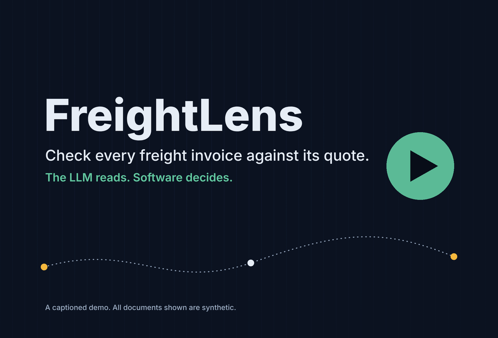
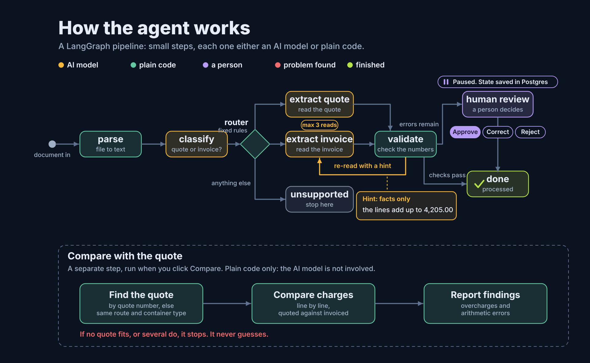
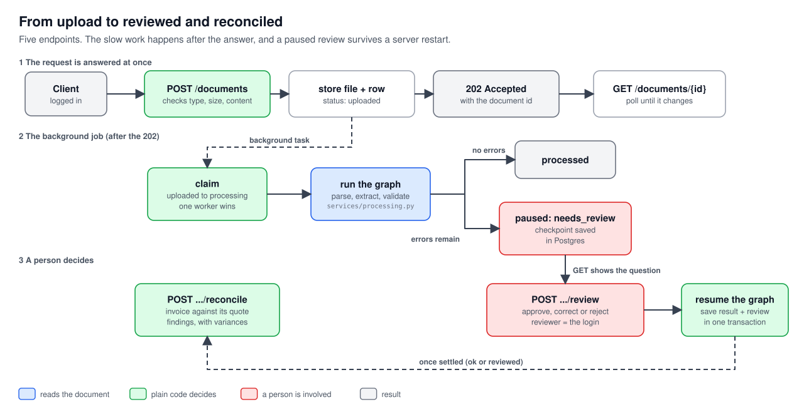
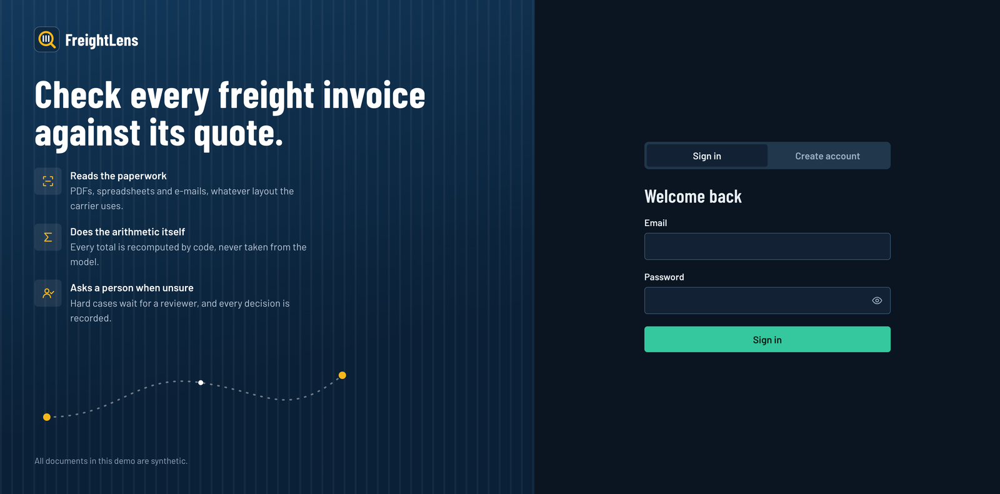
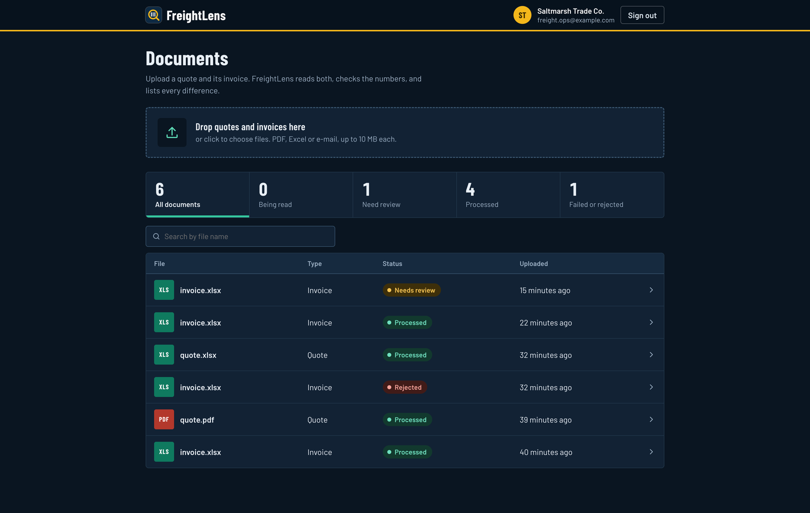
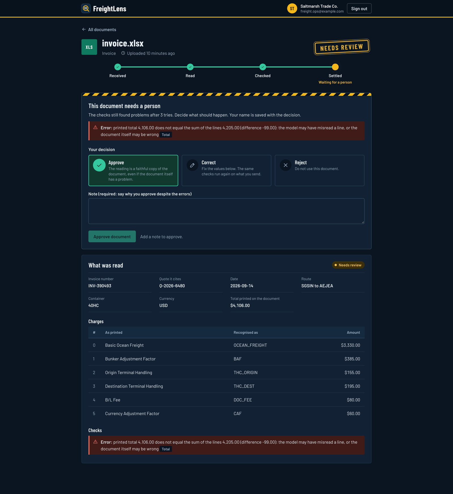
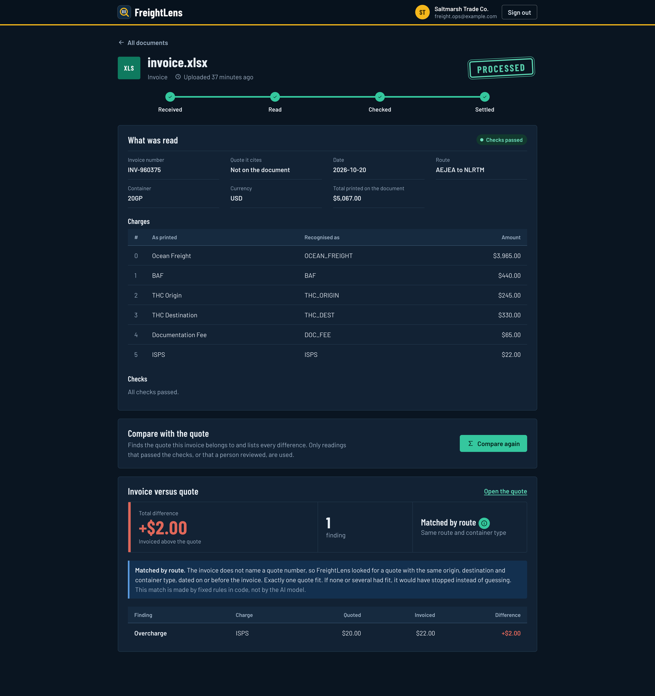
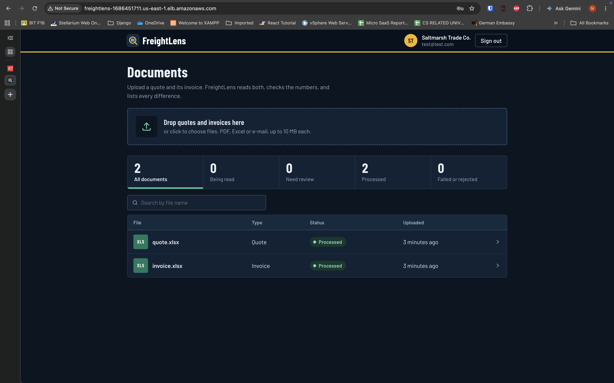
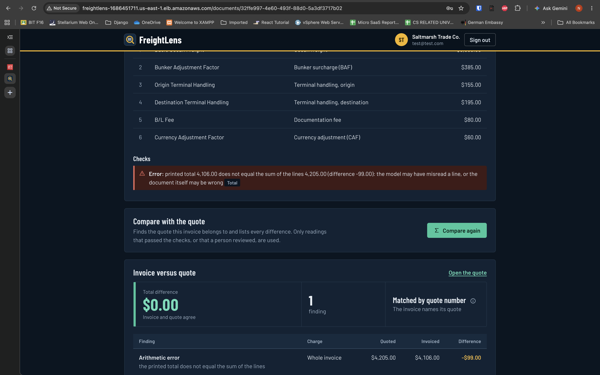
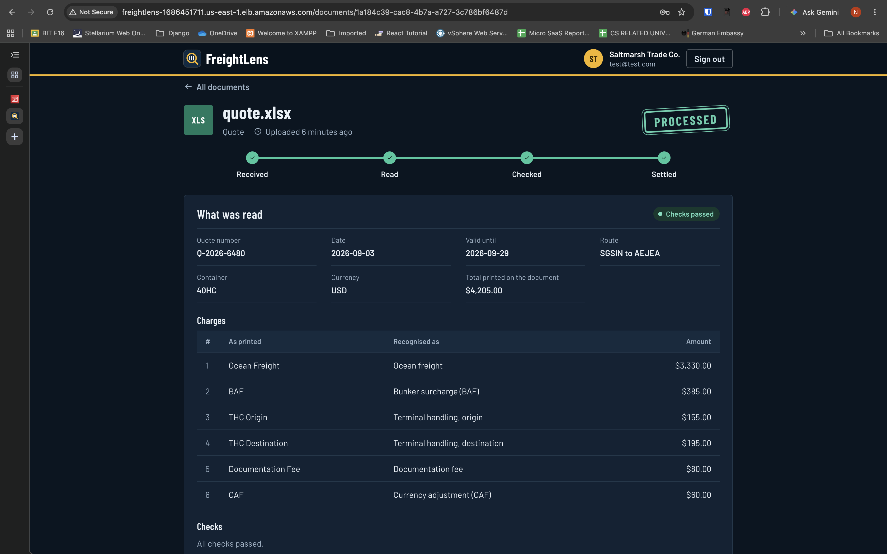

# FreightLens

[](https://github.com/fanuman/freight-doc-intelligence/actions/workflows/ci.yml)

**Freight document intelligence.** Upload a carrier quote and an invoice (PDF, Excel or e-mail), and FreightLens
extracts the charges, checks the arithmetic, and flags what needs a human. The goal is to catch things like
overcharges, missing or unquoted charges, currency mismatches and expired quotes before an invoice is paid.

> **Principle: the LLM reads, software decides.** The model only *copies* text out of messy documents.
> Deterministic code converts it to numbers, validates it, and reconciles quote against invoice.
> The model never does arithmetic or decides whether a charge is correct.

**Status: work in progress (portfolio project).** The extraction pipeline, normalization, quote-versus-invoice
reconciliation, saved results, a pause-and-resume human review step, a documents API (upload, background processing, review,
reconcile), an evaluation harness with a CI quality gate and the multi-tenant foundation are built and tested. A web app
(sign in, upload, review, compare) sits on top of it; it has been deployed to AWS with Terraform, tested, and torn down (see [Deploy to AWS](#deploy-to-aws)). All data is **synthetic** with fictional carriers; no real company documents are used.

## Demo

[](https://drive.google.com/file/d/1Ans79KVIUGE9cpHE9ucLtyvN3p2G8r8J/view?usp=drivesdk)

A captioned walkthrough: create a company account, upload a quote and an invoice, review an overcharge, settle an invoice with a wrong total, then see how the LangGraph agent works. All documents are synthetic.

## How it works


**What the pictures show.** Blue steps call an LLM and only copy text. Green steps are plain code that converts, checks and decides.
The pipeline is a [LangGraph](https://langchain-ai.github.io/langgraph/) state graph, and every run is traced in LangSmith.

### The whole flow in one picture



Amber steps call the AI model, teal steps are plain code, purple is a person. The model only reads. If the total does not add up, it re-reads with a hint made of facts (never the answer), at most 3 reads in all. If it still fails, the run pauses with its state saved in Postgres until a person approves, corrects or rejects. Comparing an invoice with its quote is a separate step, and it is plain code only.

### What happens when a document is processed


Each arrow is a function call. The graph holds one shared *state* (a dictionary), and every step returns only the keys it adds.
After each step, a small *router* function reads the state and says which step comes next.

### The state, step by step (a real repair)


In this synthetic invoice the model first read `USD 4 195.00` as `195.00`. The validation code noticed the lines no longer added up
to the printed total, wrote a hint, and the graph went back to the extractor, which read it correctly the second time.

**The repair loop.** A model can misread a number (for example `USD 4 195.00` read as `195.00`). When the charge lines no
longer add up to the printed total, the graph goes back to the extractor with a hint built from the computed sums
("your charges add up to X but the printed total is Y"). The hint never contains the right answer. A document whose
printed total really is wrong stays wrong after the retries and goes to a human, so the loop cannot hide a genuine error.

### Normalization: many spellings, one code

Carriers spell the same charge differently (`Ocean Freight`, `O/F`, `Sea Freight`), and ports and container types vary too
(`Jebel Ali (AEJEA)`, `40' High Cube`, `40HQ`). After extraction, plain code maps each one to a canonical code
(`OCEAN_FREIGHT`, `AEJEA`, `40HC`) using an exact lookup table, so a quote and an invoice can be compared by code rather than by wording.
A label that is not in the table becomes `OTHER` and is flagged for a human. It is never guessed: a fuzzy match would silently
file an unquoted surcharge under a quoted one, which is exactly the thing this tool exists to catch.

### Reconciliation: did the carrier invoice what it quoted?

With every charge in canonical form, plain code compares a quote with its invoice. First it finds the quote: the one the
invoice cites, or else the only quote on the same route and equipment issued before the invoice date. If the cited quote is
missing or several quotes fit, it stops and a human decides; it never guesses. Then it compares charge by charge, forgiving
a difference of up to 1 cent or 0.5% (rounding), and reports: overcharge, undercharge, unquoted charge, missing charge,
currency mismatch, expired quote, and an arithmetic error in the printed total. All money is integer cents, never floats,
and no model is involved in this step.

### Saved results

Results are stored in Postgres: one extraction per document (the model's raw output as JSONB for audit, plus typed columns
for queries), its charges, and one reconciliation per invoice with a row for each discrepancy. Saving is a single
transaction, so a crash leaves nothing half-written, and processing a document again replaces the old rows instead of
duplicating them. Every table carries the same row-level security policy, and child rows point at their parent by
`(tenant_id, id)`, so even a bug in application code cannot link one company's data to another's (Postgres checks plain
foreign keys without applying row-level security, so the composite key is what closes that gap).

### Human review: the graph pauses for a person

When validation still finds errors after the retries (for example an invoice whose printed total really is wrong), the graph
does not guess and does not dead-end. It **pauses** at a review step, saves its whole state (a LangGraph *checkpoint*, one
thread per document), and waits. A reviewer then approves, corrects or rejects it, and the graph resumes from where it
stopped. A correction is checked by the same validation code as the model's reading, approving over an error
requires a written note, and every decision records who made it. The rules live in plain functions (`pipeline/review.py`) that
are tested without LangGraph; LangGraph only provides the pause, the checkpoint and the resume. The checkpoint is stored in Postgres, so a paused review survives a server restart (a test proves a brand-new connection pool resumes it).

### The documents API: upload, review, reconcile



| Endpoint | What it does |
|---|---|
| `POST /documents` | Upload a PDF, Excel or e-mail file. Checked by extension **and** content, size-capped. Answers `202` with the id at once; a background task reads it. |
| `GET /documents` | The company's documents, newest first, with paging. |
| `GET /documents/{id}` | Status, what was read, the findings, the review history and, while it waits, the question a person must answer. |
| `POST /documents/{id}/review` | Approve, correct or reject a document that is waiting. The reviewer is always the logged-in user. |
| `POST /documents/{id}/reconcile` | Compare an invoice with its quote. Only readings that are settled (checks passed, or a person reviewed them) are used. |

Things worth knowing: a client's filename is only ever shown, never used as a path; two workers can never process the same
document (one atomic `UPDATE ... WHERE status = 'uploaded'` decides who wins); when a review decision is saved, the result and
the audit row are written in one transaction; and every decision is kept in an append-only `reviews` table. Known limits: the
background task is lost if the server dies mid-run (the document stays `processing`), and a review that fails three times in a
row ends unfinished until the document is uploaded again.

### The web app

A thin Next.js + TypeScript app in [`web/`](web/) uses that API. Three screens:

- **Sign in / create a company account.**
- **Documents:** upload a quote or an invoice (PDF, Excel or e-mail), see the list, and watch each status change by itself.
- **One document:** what was read, the checking code's findings and, when the model could not settle a document, a **review panel**
  to approve, correct or reject it. For an invoice, a **Compare with the quote** button shows every difference with its amount.

**Sign in** (a company account; every company only sees its own documents):



**Documents:** filter by status, search by file name, and watch each status change on its own:



**Review:** the invoice's printed total is $99 below the sum of its own lines. The checking code finds it and stops; a person
decides, and the decision is saved with their name:



**Compare with the quote:** every difference with its amount, and a note on how the quote was found (by plain rules in code,
not by the model):



All screenshots use the synthetic demo data, not real documents.

The browser only talks to `/api/...`; Next.js forwards that to FastAPI, so everything is one origin and the API needs no CORS
settings. The screens add no business rules: every decision, including a human correction, is checked again by the backend.
Known limits: the reviewer does not yet see the original file next to the values (no download endpoint), the login token lives in
`sessionStorage` (a production app would use an httpOnly cookie), and the list polls every 3 seconds instead of receiving pushes.

## Multi-tenant foundation

Each company's data is isolated by Postgres **row-level security**, not just by application code.


Code is layered so each file has one job: **routes** (`api/routes`, HTTP in and out) call **services** (business rules), which call
**repositories** (database queries), which use **models** (tables). **Schemas** describe request and response shapes.

API endpoints today: `GET /healthz`, `POST /auth/register`, `POST /auth/login`, `GET /me`, and the five `/documents` endpoints above.

## How it is tested

Real freight documents are not used. A generator creates quote and invoice pairs in three formats with the exact answer saved
alongside, so every number the pipeline extracts can be scored.


The dataset has 45 cases (90 documents) from 4 fictional carriers, with clean invoices plus 7 scenario types (overcharge, unquoted charge,
missing charge, currency mismatch, expired quote, harmless rounding noise, arithmetic error) and 7 invoices containing
prompt-injection text such as "ignore previous instructions". A free *oracle* model (a pretend perfect extractor) tests the
scoring code itself before any money is spent.

### Latest results (gpt-4o-mini, 90 synthetic documents)

| Metric | Result |
|---|---|
| Document type classification | 100% |
| Field accuracy (reference, dates, currency, ports, container type, total) | 100% |
| Charge extraction F1 (label and amount must both match) | 100% |
| Invoices with a genuinely wrong total that were flagged | 5 of 5 |
| False alarms on correct invoices | 0 of 40 |
| Prompt-injection invoices leaking into the output | 0 of 7 |
| Charge-code accuracy (canonical code per correctly read charge) | 100% |
| Wrong codes that were not flagged ("confident wrong") | 0 |
| Unknown charge labels flagged for a human | 3 of 564 (the genuinely unknown surcharges) |
| Repair loop | misread totals are re-read up to twice; a document that is really wrong stays flagged |
| Reconciliation findings vs. the generator's answer (perfect extraction, not the real model) | exact match on all 45 cases |
| Cost of a full run | about $0.03 |

How the first baseline improved: charge F1 was 78.5% because the model appended table columns like "per container" to charge
names; one prompt rule fixed it (99.8%), and the repair loop fixed the last misread digit (100%).

**Read these numbers honestly:** the data is synthetic and was produced by my own generator, and the prompt was tuned on the
same 90 documents it is scored on. They show the system works on this dataset, not what accuracy on real-world documents would be.
The normalization table was written knowing the generator's spellings, so its 100% shows the wiring works, not that it
covers real carriers' wording; on real documents the number to watch is how often labels are flagged.

## Continuous integration and the quality gate

Every push runs [GitHub Actions](.github/workflows/ci.yml): it starts a throwaway Postgres, applies the migrations, runs all tests,
then evaluates the pipeline with the free oracle model through a **quality gate** (`eval_thresholds.json`). If a metric falls
below its limit, or a metric goes missing, the run turns red. Real-model quality is measured by a separate workflow that only
runs when started by hand, so a push never spends money.

## Quick start

Requires Python 3.10+ and Docker.

```bash
# 1. database
cp .env.example .env            # then fill in the values (never commit .env)
docker compose up -d            # Postgres on localhost:5433

# 2. install
python -m venv .venv && source .venv/bin/activate
pip install -e ".[dev]"
alembic upgrade head            # creates tables, roles and row-level security
python -m freight_intel.pipeline.checkpoint   # one-time: creates LangGraph's checkpoint tables (as the owner role)

# 3. run the tests (needs the database running)
pytest -v

# 4. run the API
uvicorn freight_intel.api.main:app --reload     # docs at http://localhost:8000/docs

# 4b. run the web app (second terminal); needs the API from step 4 running on port 8000
cd web && npm install && npm run dev            # http://localhost:3000

# 5. generate the synthetic dataset and score the pipeline
python -m freight_intel.synth                    # writes data/synthetic/ (gitignored)
python -m freight_intel.evaluation --llm oracle  # free: a pretend perfect model, tests the scoring
python -m freight_intel.evaluation --llm oracle --gate eval_thresholds.json   # same, and exit with an error if a limit is broken
python -m freight_intel.evaluation --llm openai  # needs OPENAI_API_KEY, about $0.03
```

Environment variables (names only; see `.env.example`): `POSTGRES_USER`, `POSTGRES_PASSWORD`, `POSTGRES_DB`, `APP_DB_USER`,
`APP_DB_PASSWORD`, `JWT_SECRET`, and for the pipeline `OPENAI_API_KEY` (uploads answer 503 without it), `LANGSMITH_API_KEY`,
`LANGSMITH_PROJECT`. Optional: `STORAGE_DIR` (default `storage`, a folder) and `MAX_UPLOAD_BYTES` (default 10 MB).
On AWS the same code runs with `STORAGE_BACKEND=s3` plus `S3_BUCKET` and `AWS_REGION`, and `DB_HOST`/`DB_PORT` pointing at RDS
(set by Terraform, see below).

## Deploy to AWS

The whole stack is one Terraform folder, `infra/`. It was deployed, tested in a browser on a plain load-balancer address,
and then destroyed with `terraform destroy` so nothing keeps costing money (about $0.09 an hour while it is up).

```
internet --HTTP:80--> load balancer --3000--> ECS Fargate task [ web :3000 + api :8000 ] --5432--> RDS Postgres 16
                                                                   |
                                                                   +--> S3 (uploaded documents)    Secrets Manager (secrets)
```

- **Stateless containers.** The API image keeps nothing on its own disk: documents go to S3 (`STORAGE_BACKEND=s3`), data goes to
  RDS. Replacing the task loses nothing.
- **No keys in the app.** The task has an IAM role that can read and write one bucket and nothing else; a separate execution role
  lets ECS pull the images and read exactly four secrets.
- **Secrets stay out of images, code and git.** The database password is created and kept by RDS itself; the JWT secret and the
  app-role password are generated by Terraform; the OpenAI key is put in from the operator's own terminal.
- **Chained firewalls.** Internet to load balancer only; the load balancer to the web container only; the database accepts only the
  app task.
- **An empty database is prepared by one command**, `python -m freight_intel.bootstrap`, run as a one-off ECS task: it creates the
  limited app role that row-level security applies to, runs the migrations and sets up the checkpoint tables. It is safe to repeat.
- **Safe first apply.** The service starts with `desired_count = 0`, so nothing runs until the images are pushed and the database is ready.

The step-by-step runbook (apply, push the images, bootstrap, store the key, start, destroy, check nothing is left) is in
[`infra/README.md`](infra/README.md).

**Running on AWS** (the load-balancer address is in the browser bar; synthetic demo data only):







Known limits of this deployment (what a production version would change): plain HTTP with no domain or certificate; the default
VPC with public subnets and no NAT gateway (only the load balancer can reach the task, but private subnets would be better);
Terraform state is a local file that holds the generated secrets (production: an encrypted remote backend with locking); the
database has no backups, standby or deletion protection so that destroy is quick; processing runs inside the API process (production:
a queue and workers); no alarms and no automatic deploy pipeline yet.

## Project layout

The pictures above are drawn by `docs/diagrams/build_diagrams.py` (plain Python, no dependencies). Edit it, run it, and commit the updated files in `docs/images/`.


```
src/freight_intel/
  api/          FastAPI app, routes and dependencies
  services/     business rules (sign-up, login, upload checks, processing and review, saving results, reconciling)
  repositories/ database queries
  models/       SQLAlchemy tables
  schemas/      request and response shapes
  pipeline/     parse, classify, extract, validate, normalize, reconcile, repair loop, human review (LangGraph)
  evaluation/   scoring, the evaluation command line and the quality gate
  synth/        synthetic document generator and the oracle test model
  storage.py    where uploaded files are kept (a folder locally, an S3 bucket on AWS)
  bootstrap.py  prepares an empty database: app role, tables, checkpoint tables (run once on AWS)
web/            Next.js + TypeScript web app (sign in, upload, review, compare)
infra/          Terraform for AWS (ECS Fargate, load balancer, RDS, S3, Secrets Manager) and the deploy runbook
Dockerfile      API image (the web image is web/Dockerfile); docker-compose.yml runs database, api and web locally
migrations/     Alembic migrations (tables, roles, row-level security, results, reconciliation, reviews)
tests/          unit, integration and evaluation tests
docs/           design document, images/ (README pictures), diagrams/ (script that draws them)
.github/        CI workflows (tests and gate on every push; real-model evaluation by hand)
eval_thresholds.json   limits the evaluation gate checks
```

## Roadmap

| Step | Status |
|---|---|
| Design document | done |
| Multi-tenant Postgres, row-level security, auth, API | done |
| Synthetic dataset with ground truth | done |
| Extraction pipeline, LangGraph, LangSmith tracing, evaluation | done |
| Repair loop for misread totals | done |
| Normalization to canonical charge, port and container codes | done |
| Quote-versus-invoice reconciliation | done |
| Save results (extractions, charges, reconciliations) with tenant isolation | done |
| Human review (pause and resume) | done |
| Documents API: upload, background processing, review, reconcile; checkpoints in Postgres | done |
| CI with an evaluation quality gate | done |
| Web app: sign in, upload, review, compare | done |
| Demo screenshots | done |
| Demo short video | done |
| Container images (API and web), Docker Compose full stack | done |
| S3 storage backend and bootstrap command for an empty database | done |
| Deployment to AWS with Terraform (ECS Fargate, ALB, RDS, S3), tested and destroyed | done |

See [`docs/design-doc.md`](docs/design-doc.md) for the full design and the reasoning behind these choices.
